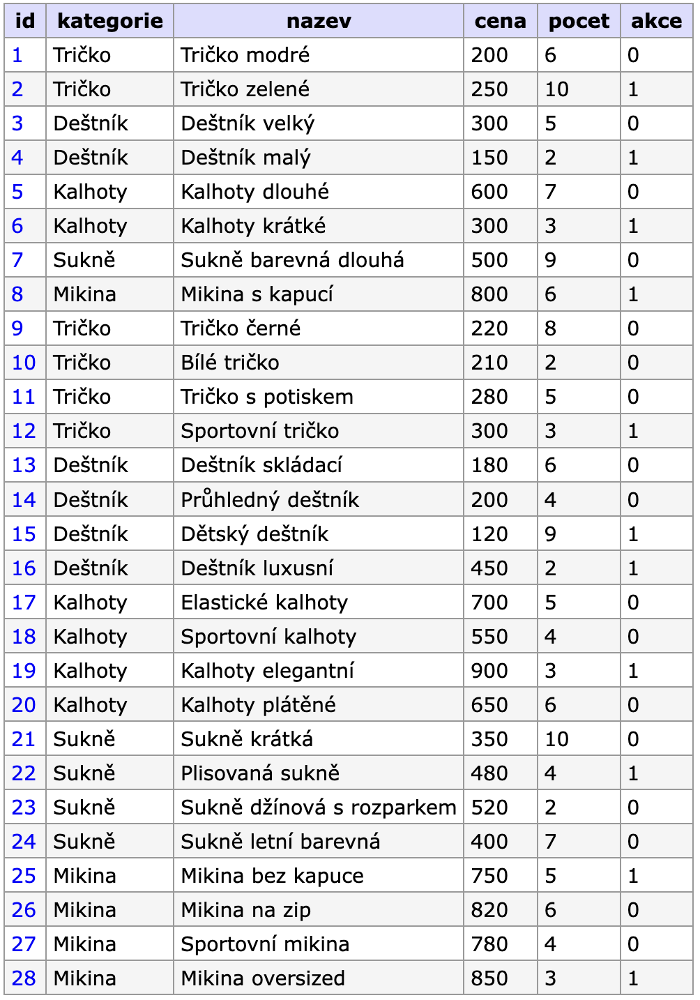
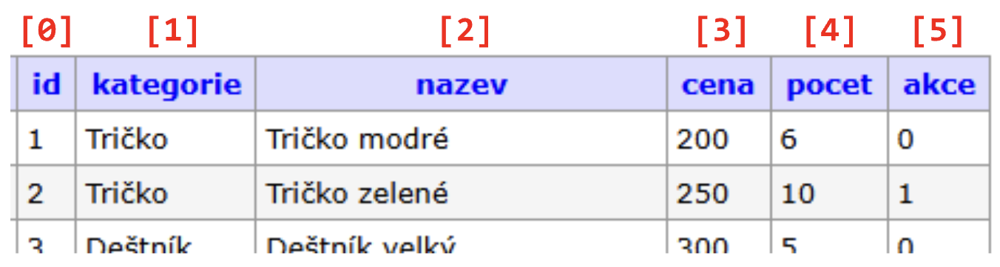

# Projekt eshop (1)

> - **Založení projektu + výpis jednoho produktu**
> - Živá ukázka: [tux.panska.cz/~machac/eshop/produkt.php](https://tux.panska.cz/~machac/eshop/produkt.php)
> - Výpis jednoho záznamu (skript `produkt.php`)

---

V tomto projektu budeme s daty z tabulky `sklad`. Vypadá nějak takto:




# Adminer

- Adresa: [https://tux.panska.cz/adminer](https://tux.panska.cz/adminer)
- Jméno: `kdokoli`
- Heslo: `kdokoli`

Tento účet je "univerzální" - umožňuje přístup ke všem tabulkám databáze `cvicne`, ale jen pro čtení.

Prostředí Adminer se používá pro vytvoření databází a tabulek. Samotná práce s daty se ale provádí prostřednictvím webové aplikace napsané v našem případě v jazyce PHP.

PHP podporuje několik databázových systémů. I když k práci s každým z nich slouží jiné funkce, jejich použití i jména jsou velice podobná. Obecně můžeme říct, že funkce pro práci s určitým databázovým systémem začínají jeho názvem. PHP tak obsahuje funkce začínající na `mysqli_`, které slouží pro práci s MySQL (v našem případě MariaDB). Funkce začínající na `pgsqli_` slouží pro práci s PostgreSQL atp.

V PHP probíhá práce s databázemi a daty ve třech krocích:

1. Připojení k SQL serveru jménem a heslem.
2. Samotnou manipulací s daty a databázemi prostřednictvím jazyka SQL (`SELECT`, `UPDATE`, `INSERT` apod.). Zde se kombinují jazyky PHP, HTML a SQL.
3. Ukončení spojení s SQL serverem.

Tento proces lze považovat za obecný i v jiných SQL systémech.

## Aplikace pro vzdálenou správu souborů

- Osvědčená kombinace **VSCode + SSH Client**


# Založení projektu eshop

Na serveru TuX si vytvořte adresář a přesuňte se do něj:

```
$ mkdir ~/www/eshop
$ cd ~/www/eshop
```

<mark>!!! VŠECHNY OSTATNÍ SKRIPTY BUDOU V TOMTO ADRESÁŘI !!!</mark>   


# Skript `conn.php`

Vždy, když budeme chtít pracovat s nějakou databází, musíme se k ní **nejdříve připojit**. Stejně jako v našem případě totiž můžeme mít na databázovém serveru několik databází a musíme se připojit k té, se kterou chceme pracovat. 

Skript `conn.php` bude obsahovat:

```php
<?php
  $host = 'localhost';  
  $uzivatel = 'kdokoli'; 
  $heslo = 'kdokoli'; 
  $databaze = 'cvicne';

  //promenna  definujici pripojeni  
  $db = mysqli_connect($host, $uzivatel, $heslo, $databaze) 
  or die("Chyba spojení: " .  mysqli_connect_error());
  
  // Nastavení kódování pro správnou češtinu UTF-8 "Multibyte"
  mysqli_set_charset($db, "utf8mb4");
?>
```

Proměnná `$db` nese informace o přihlašovacích údajích a jiných proměnných. Pokud se připojení z nějakého důvodu nezdaří – `or die()`, vypíše skript chybu “`Chyba spojení:…`” a ukončí svůj běh i běh skriptu, který jej zavolal.

Vyzkoušejte načtením skriptu na URL: 
```
https://tux.panska.cz/~10XPrijmeniJ/eshop/conn.php
```
Pokud se vypíše prázdná stránka, je vše v pořádku.


# Společné části

Každá stránka má kus kódu společný. V PHP je efektivní a snazší na správu si je uložit do samostatných souborů a pak se na ně jen odkazovat.

## Skript `header.php`

Hlavička stránky a připojení k databázi:

```php
<!DOCTYPE html>
<html lang="cs">
<head>
  <meta charset="UTF-8">
  <link rel="stylesheet" href="styles.css">
  <title>E-shop</title>
</head>
<body>
<div class="obal">
<h1>E-shop s oblečením a doplňky</h1>
<?php require "conn.php"; ?>
```

## Skript `footer.php`

Tady bude uzavření spojení s databází, odkaz na domovskou stránku a konec těla `div`, `body` a `html`:

```php
<?php
  mysqli_close($db); //uzavření spojení
?>

<hr>

<a href="index.php">Domů</a>

</div>
</body>
</html>
```

Na dalších stránkách stačí oba skripty jen "includovat":

```php
<?php include "header.php" ?>

<?php include "footer.php" ?>
```

Technicky to funguje tak, že místo `include "header.php"` vloží PHP překladač kód, který je v odkazovaném souboru.

- `include` - pokud se soubor nenajde, skript pokračuje dál
- `require` - pokud se soubor nenajde, skript se okamžitě ukončí

## Styly `styles.css`

Pro začátek budou stačit tato primitivní úprava vzhledu:

```css
body { 
  font-family: Arial, sans-serif;
  margin-top: 2em;
}

.obal { 
  max-width: 800px;
  margin: auto;
}

hr {margin-top: 2em;}

a:hover {color: red;}
```

## Skript `index.php`

Ten bude sloužit jako primitivní "rozcestník" webu. Bude obsahovat odkazy na další skripty tak, jak budou postupně vznikat. Jelikož jsme v PHP, není problém si jej naskriptovat.

```php
<?php include "header.php" ?>
<h2>Menu</h2>
<ol>
  <li><a href="produkt.php">Výpis jednoho produktu</a></li>
</ol>
<?php include "footer.php" ?>
```

## Skript `produkt.php`

Tento skript vypíše jeden náhodný záznam z tabulky sklad.

```php
<?php
include "header.php";

$sql = "SELECT * FROM sklad WHERE id = 2";
$vysledek = mysqli_query($db, $sql);

$pole = mysqli_fetch_row($vysledek);
echo $pole[0] . ": " . $pole[2] . " - " . $pole[4] . " ks";
mysqli_free_result($vysledek); //uvolnění paměti

include "footer.php";
?>
```



- `mysqli_query()` - První předávaný parametr této funkce je odkaz na databázi, druhým parametrem předáváme SQL příkaz. Pokud provádíme například jen UPDATE nebo smazání DELETE záznamu, žádný další příkaz nepotřebujeme spouštět. Avšak chceme-li získat data, musíme zpracovat návratové hodnoty, tzv. result set. K tomu slouží řada funkcí.
- `mysqli_fetch_row()` - načítání pomocí **číselných indexů**.
- `mysqli_free_result()` - "vyčistí" mezipamět s výsledky 


Výpis pomocí [číselných indexů](https://www.w3schools.com/php/php_arrays_indexed.asp) není příliš komfortní. Praktičtější je pomocí [asociativního pole](https://www.w3schools.com/php/php_arrays_associative.asp):

```php
$pole = mysqli_fetch_assoc($vysledek);
echo $pole['id'] . ": " . $pole['nazev'] . " - " . $pole['pocet'] . " ks"; //dodržet velikost znaků názvů polí
```

- `mysqli_fetch_assoc()` - Funkce vrací hodnoty v asociativním poli. Jednotlivé prvky pole jsou asociovány s názvy sloupců v dané tabulce. Stačí tedy vědět jaké jsou názvy sloupců a můžeme s nimi přímo pracovat jejich uvedením v hranaté závorce `$pole['id']`, `$pole['nazev']`, apod. 

Jinými slovy, `$pole['nazev_pole']` je běžná proměnná.


---

# 💾 Úkoly

Vytvořte další skript `nabidka-dne.php` – v menu bude "Doporučujeme". Kostra skriptu:

```php
<?php
include "header.php";
echo "<h2>Doporučujeme</h2>";

$sql = "SELECT * FROM sklad";
$vysledek = mysqli_query($db, $sql);
$pole = mysqli_fetch_assoc($vysledek);

// zde bude výkonný kód a výstup

mysqli_free_result($vysledek); //uvolnění paměti
include "footer.php";
?>
```

Skript po každém zobrazení (načtení) stránky vypíše:

1. Jeden náhodný produkt. Stačí upravit SQL dotaz takto: náhodně seřadit řádky v tabulce `ORDER BY RAND()` a nechat vypsat jeden řádek `LIMIT 1`.<br><br>
2. Ve výpisu se zobrazí pole **Kategorie**, **Název**, **Cena**.<br><br> 
3. Dále pak slovní informace "Akční cena", pokud je zboží v akci, pokud ne informaci "Standardní cena". Otestovat hodnotu `$pole['akce']` a na základě ní vypsat požadovaný text pomocí `echo`.<br><br>
4. Pokud bude počet kusů 5 a méně, zobrazí se navíc informace "Poslední kusy na skladě". Otestovat hodnotu `$pole['pocet']` a na základě ní vypsat požadovaný text pomocí echo.

Výsledek může vypadat nějak takto ([živá ukázka](https://tux.panska.cz/~machac/eshop/nabidka-dne.php)):

---


---

**Hodnocení:**
- 4 úkoly	.. 1
- 3 úkoly	.. 2
- 2 úkoly	.. 3
- 1 úkol	.. 4
- žádný úkol	.. 5 

