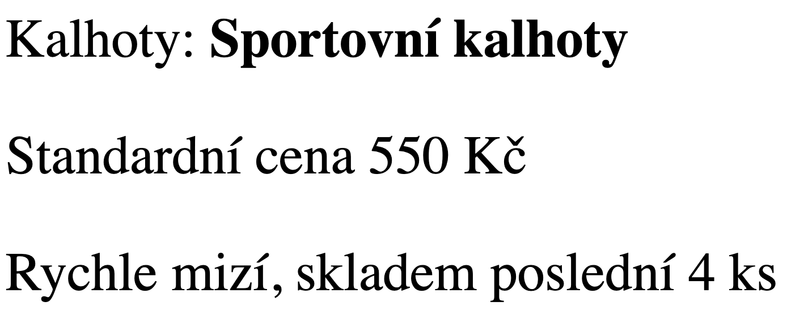

# Projekt eshop (2)

> - **Nabídka dne** (výpis náhodného produktu)
> - Živá ukázka: [tux.panska.cz/~machac/eshop/nabidka-dne.php](https://tux.panska.cz/~machac/eshop/nabidka-dne.php)
> - Skript `nabidka-dne.php`


## 💾 Úkoly

Vytvořte skript `nabidka-dne.php` – v menu bude "Doporučujeme". Kostra skriptu:

```php
<?php
include "header.php";
echo "<h2>Doporučujeme</h2>";

$sql = "SELECT * FROM sklad";
$vysledek = mysqli_query($db, $sql);
$pole = mysqli_fetch_assoc($vysledek);

// zde bude výkonný kód a výstup

mysqli_free_result($vysledek); //uvolnění paměti
include "footer.php";
?>
```

Skript po každém zobrazení (načtení) stránky vypíše:

1. Jeden náhodný produkt. Stačí upravit SQL dotaz takto: náhodně seřadit řádky v tabulce `ORDER BY RAND()` a nechat vypsat jeden řádek `LIMIT 1`.<br><br>
2. Ve výpisu se zobrazí pole **Kategorie**, **Název**, **Cena**.<br><br> 
3. Dále pak slovní informace "Akční cena", pokud je zboží v akci, pokud ne informaci "Standardní cena". Otestovat hodnotu `$pole['akce']` a na základě ní vypsat požadovaný text pomocí `echo`.<br><br>
4. Pokud bude počet kusů 5 a méně, zobrazí se navíc informace "Poslední kusy na skladě". Otestovat hodnotu `$pole['pocet']` a na základě ní vypsat požadovaný text pomocí echo.

Výsledek může vypadat nějak takto ([živá ukázka](https://tux.panska.cz/~machac/eshop/nabidka-dne.php)):

---


---

**Hodnocení:**
- 4 úkoly	.. 1
- 3 úkoly	.. 2
- 2 úkoly	.. 3
- 1 úkol	.. 4
- žádný úkol	.. 5 

