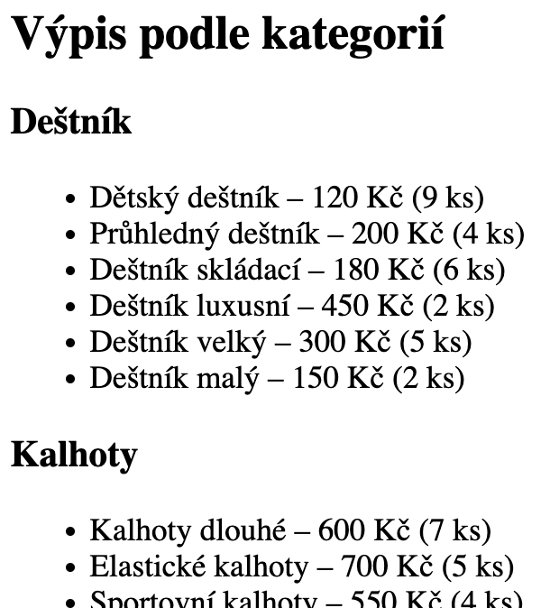

# Projekt eshop (3)

> - **Výpis více záznamů najednou**
> - Živá ukázka: [tux.panska.cz/~machac/eshop/all.php](https://tux.panska.cz/~machac/eshop/all.php)
> - Skript `all.php`

---

Výběr dat z databázových tabulek je prakticky nejpoužívanějším úkonem ve webových aplikacích - vyhledávače, e-shopy, katalogy. Existuje mnoho možností, jak vytvořit dotaz do databáze tak, abychom získali přesně ty informace, které chceme. Při výpisu informací z databáze budeme velmi často využívat možnost vypsat víc záznamů najednou. Jedním dotazem do databáze tak získáme data z několika záznamů, které poté vypíšeme.

Pro takový výběr můžeme použít následující skript, kterým vypíšeme všechny záznamy z tabulky sklad.

# Skript `all.php`
Vytvořte nový soubor `~/www/eshop/all.php`, který bude obsahovat tuto kostru:

```php
<?php
include "header.php";
<h1>Výpis všech produktů</h1>

//zde bude PHP kód

include "footer.php";
?>
```

Nezapomeňte do souboru `index.php` přidat odkaz na tuto stránku. Do něj vložíme tento kód, který vypíše všechny záznamy uvedených polí:

```php
$sql = "SELECT kategorie, nazev, cena, pocet FROM sklad";
$vysledek = mysqli_query($db, $sql);

while($pole = mysqli_fetch_assoc($vysledek))
{
  echo $pole['kategorie'] . " - " . $pole['nazev'] . ": " . $pole[cena] . " Kč" . $pole['pocet'] . " ks<br>";
}
```

Podmínka `$radek = mysqli_fetch_assoc($vysledek)` znamená, že se budou vypisovat jednotlivé záznamy, dokud bude co vypisovat – dokud nevypíšeme všechny záznamy, které nám databáze poskytla. Všimněte si jednoduchého rovnítka `=` ve významu přiřazení, nikoliv rovnosti `==`.

<mark>**Otázka:**</mark> Jak cyklus `while` pozná, že vypsal poslední záznam (řádek)?

---

# 💾 Úkol

Vytvořte další stránku `podle-kategorii.php`, přidejte kostru a stránku přidejte do navigace (soubor `index.php`).

```php
<?php
include "header.php";
<h1>Výpis podle kategorií</h1>

//zde bude PHP kód

include "footer.php";
?>
```

V databázové tabulce `sklad` jsou uloženy informace o produktech. Každý produkt má mimo jiné:

- kategorii (např. Tričko, Mikina, Kalhoty...),
- název,
- cenu,
- počet kusů na skladě.

Vaším úkolem je vytvořit PHP skript, který zobrazí přehled produktů rozdělený podle kategorií. Výstup bude vypadat nějak takto (zkráceno):


---



---

- Načtěte data z databáze pomocí SQL dotazu seřazené podle kategorie (`ORDER BY`). Každá položka seznamu bude obsahovat:
  - název produktu,
  - cenu v Kč,
  - počet kusů na skladě.  
- Každou kategorii zobrazte jako nadpis (např. pomocí `<h3>`),
- Pod nadpisem zobrazte seznam produktů v dané kategorii jako odrážkový seznam (`<ul>` a `<li>`).

**Nápověda:**

- Data z databáze získáte postupným načítáním řádků pomocí cyklu `while`.
- Přemýšlejte, jak poznáte, že začíná nová kategorie.
- Můžete si pomoci pomocnou proměnnou, ve které bude uložena aktuální kategorie.

Nezapomeňte správně otevírat a zavírat HTML značky `<ul>` a `<li>`.


**Pseudokód pro snazší pochopení logiky skriptu:**

---

- nastav `aktualni_kategorie` na prázdno (`$aktualni_kategorie = ""`)
- načti data z databáze (seřazená podle kategorie)
- pro každý řádek z databáze:
  - pokud kategorie z řádku není stejná jako `aktualni_kategorie`:
      - pokud `aktualni_kategorie` není prázdná:
          - vypiš konec seznamu `</ul>`
      - vypiš nadpis kategorie `<h3>`
      - vypiš začátek seznamu `<ul>`
      - ulož aktuální kategorii
  - vypiš položku seznamu `<li>`
      - (název, cena, počet)
- po skončení cyklu:
  - pokud nějaká kategorie byla: (`if ($aktualni_kategorie != "")`)
      - vypiš konec seznamu `</ul>`

---